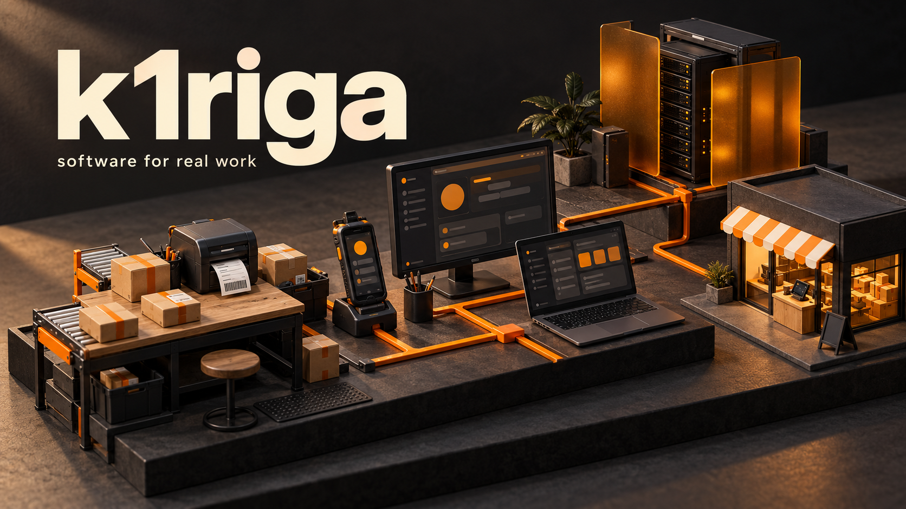
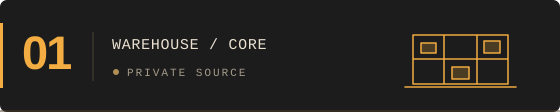
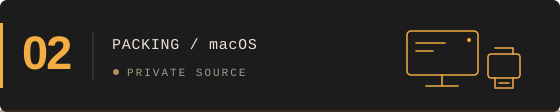
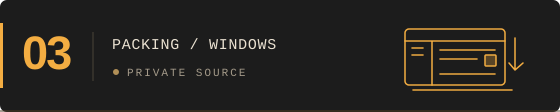
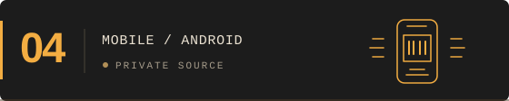
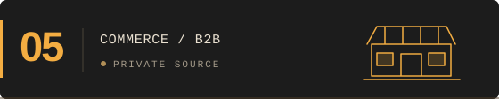
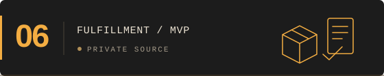

  

# Илья Ибрагимов / k1riga

Разрабатываю софт для складов и торговли. В одних проектах занимаюсь сервером и вебом, в других — приложениями для рабочих мест и складских терминалов.

[Закрытые проекты ↓](#закрытые-проекты) &nbsp; / &nbsp; [Открытый код ↓](#открытый-код) &nbsp; / &nbsp; [Написать в Telegram ↗](https://t.me/k1rigaa)

 

## Закрытые проекты

Часть работы остаётся в приватных репозиториях. Вот что я там разрабатываю — без исходников и внутренней кухни.

<table>
<tr>
<td width="50%" valign="top">

<h3>Складская WMS-платформа</h3>

Система для склада и фулфилмента: адресное хранение, приёмка, остатки, сборка, отгрузки и возвраты. Объединяет складские операции и работу с маркетплейсами.

WEB · BACKEND · ИНТЕГРАЦИИ

</td>
<td width="50%" valign="top">

<h3>Упаковочная станция · macOS</h3>

Приложение для рабочего места упаковщика: сканирование товара, проверка маркировки и печать этикеток Wildberries и Ozon. Незавершённая работа сохраняется между запусками.

macOS · СКАНЕРЫ · ЭТИКЕТКИ

</td>
</tr>
<tr>
<td width="50%" valign="top">

<h3>Складское рабочее место · Windows</h3>

Десктопный клиент для заказов и упаковки со сканерами и принтерами. Ведёт сотрудника от скана товара до проверки маркировки и готовой этикетки.

WINDOWS · DESKTOP · УПАКОВКА

</td>
<td width="50%" valign="top">

<h3>Приложение для складского ТСД</h3>

Мобильный клиент для приёмки, перемещений между ячейками и маршрутной сборки. Сотрудник получает задания и работает с товарами по сканам прямо на складе.

ANDROID · KOTLIN · ТСД

</td>
</tr>
<tr>
<td width="50%" valign="top">

<h3>Оптовый интернет-магазин</h3>

Торговая платформа с витриной, заказами и отдельной панелью управления. Пользовательская часть и инструменты магазина развиваются в одном проекте.

E-COMMERCE · ВИТРИНА · АДМИНКА

</td>
<td width="50%" valign="top">

<h3>Кабинет заявок на упаковку</h3>

Сервис для оформления работ по фулфилменту: выбор склада, подбор товаров из его остатков и заявка на упаковку. Отдельный интерфейс для организации обработки товаров.

FULFILLMENT · ЗАЯВКИ · MVP

</td>
</tr>
</table>

**Некоторые из этих проектов со временем могут стать публичными.** Когда это произойдёт, добавлю сюда репозитории и подробности.

<strong>Зачем одному складу столько приложений?</strong>

 

На терминале удобно сканировать и собирать товары. За компьютером — упаковывать, проверять маркировку и печатать этикетки. В вебе — управлять заказами и видеть общую картину.

Поэтому работаю сразу с несколькими частями процесса: у каждой своё устройство, экран и задача.

 

## Открытый код

<table>
<tr>
<td width="33%" valign="top">
<h3><a href="https://github.com/k1riga/Saas-WB-Orders-Analis">Аналитика WB ↗</a></h3>

Из заказов — в сводки по товарам. Динамика продаж и ABC/XYZ-анализ через асинхронный API.

PYTHON · FASTAPI · POSTGRESQL

</td>
<td width="33%" valign="top">
<h3><a href="https://github.com/k1riga/Saas-FRONT">SaaS Frontend ↗</a></h3>

Веб-интерфейс SaaS-проекта: страницы, графики и клиентская логика.

TYPESCRIPT · NEXT.JS · REACT

</td>
<td width="33%" valign="top">
<h3><a href="https://github.com/k1riga/TG_Bot-FuelKeeper-">FuelKeeper ↗</a></h3>

Водитель отправляет чек в Telegram, руководитель видит расходы и отчёты.

PYTHON · TELEGRAM · POSTGRESQL

</td>
</tr>
</table>

[Все публичные репозитории →](https://github.com/k1riga?tab=repositories)

 

---

**Есть что обсудить? [@k1rigaa ↗](https://t.me/k1rigaa)**

Складской софт · Web & backend · macOS · Windows · Android
