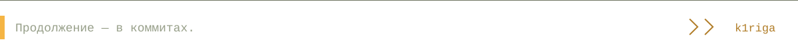

  

# Илья Ибрагимов / k1riga

Пишу софт для вполне осязаемых вещей: складов, товаров, заказов и людей, которые со всем этим работают. Где-то это сервер, где-то — приложение на терминале или компьютере, где-то — магазин или бот.

[Telegram ↗](https://t.me/k1rigaa) &nbsp; / &nbsp; [Открытые репозитории ↗](https://github.com/k1riga?tab=repositories)

 

## За закрытой дверью

**Заметная часть моей работы сейчас в приватных репозиториях.** Там разрабатываются:

- **Складские системы** — учёт и автоматизация рабочих процессов.
- **Приложения для устройств** — мобильные и десктопные клиенты, софт для складских терминалов.
- **E-commerce и фулфилмент** — инструменты для торговли и обработки заказов.

Пока рассказываю о них в общих чертах. Часть этих проектов со временем может стать публичной — тогда здесь появятся код и подробности.

<strong>А на чём всё это?</strong>

 

Python и JavaScript на сервере, TypeScript и React в вебе. Swift и Kotlin — в приложениях. PostgreSQL — для данных.

Конкретный набор зависит от задачи: бот для отчётов и складской терминал требуют разных решений.

 

## Уже можно заглянуть

Несколько открытых проектов — чтобы было что посмотреть руками.

### [↳ Аналитика Wildberries](https://github.com/k1riga/Saas-WB-Orders-Analis)

Из заказов — в сводки и аналитику по товарам. Динамика продаж, ABC/XYZ-анализ, асинхронный API.

PYTHON · FASTAPI · POSTGRESQL

### [↳ SaaS Frontend](https://github.com/k1riga/Saas-FRONT)

Веб-интерфейс для SaaS-проекта: страницы, графики и клиентская логика.

TYPESCRIPT · NEXT.JS · REACT

### [↳ FuelKeeper](https://github.com/k1riga/TG_Bot-FuelKeeper-)

Водитель отправляет чек в Telegram, руководитель видит расходы и отчёты. Меньше сообщений «а куда делся этот чек?».

PYTHON · TELEGRAM BOT · POSTGRESQL

 

---

**Пообщаться о разработке или обсудить задачу → [@k1rigaa](https://t.me/k1rigaa)**

  

