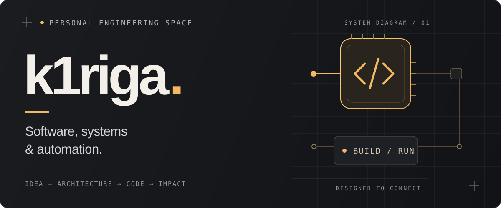

  

<h1 align="center">Илья Ибрагимов</h1>

  <strong>Сервисы. Интерфейсы. Автоматизация.</strong> 
  Превращаю бизнес-задачи в работающие инструменты.

  <a href="https://t.me/k1rigaa">Написать в Telegram ↗</a>
  &nbsp; · &nbsp;
  <a href="#выбранные-проекты">Посмотреть проекты ↓</a>
  &nbsp; · &nbsp;
  <a href="https://github.com/k1riga?tab=repositories">Все репозитории ↗</a>

 

## 01 / Чем занимаюсь

Разрабатываю backend-сервисы, веб-интерфейсы и Telegram-ботов. Мне интересны задачи, где код помогает наладить конкретный процесс: собрать данные, разобраться в продажах, учесть расходы или убрать ручную работу.

| Направление | В работе |
| :--- | :--- |
| **Backend & API** | Python, FastAPI, асинхронная обработка, интеграции |
| **Web-интерфейсы** | TypeScript, React, Next.js, Tailwind CSS |
| **Данные & автоматизация** | PostgreSQL, аналитика маркетплейсов, Telegram-боты |

 

## Выбранные проекты

02 / SELECTED WORK

### [01 — Аналитика Wildberries ↗](https://github.com/k1riga/Saas-WB-Orders-Analis)

Микросервис, который превращает данные заказов в понятную аналитику: сводки за период, динамику по часам, ABC/XYZ-анализ и показатели по товарам.

`Python` &nbsp; `FastAPI` &nbsp; `PostgreSQL` &nbsp; `asyncpg`

[Посмотреть backend →](https://github.com/k1riga/Saas-WB-Orders-Analis) &nbsp; · &nbsp; [Планировщик заказов →](https://github.com/k1riga/Saas-WB-Orders-plan)

---

### [02 — SaaS Frontend ↗](https://github.com/k1riga/Saas-FRONT)

Веб-интерфейс SaaS-проекта. Клиентская часть на Next.js и TypeScript с компонентами React, графиками Recharts и анимациями Framer Motion.

`TypeScript` &nbsp; `Next.js` &nbsp; `React` &nbsp; `Tailwind CSS`

[Посмотреть интерфейс →](https://github.com/k1riga/Saas-FRONT)

---

### [03 — FuelKeeper ↗](https://github.com/k1riga/TG_Bot-FuelKeeper-)

Telegram-бот для учёта расходов водителей: регистрация с одобрением, загрузка чеков, категории трат и ежемесячная отчётность для руководителя.

`Python` &nbsp; `python-telegram-bot` &nbsp; `PostgreSQL`

[Посмотреть бота →](https://github.com/k1riga/TG_Bot-FuelKeeper-)

 

## 03 / Как я смотрю на разработку

Сначала — задача и люди, которые будут пользоваться результатом. Затем — понятная архитектура, аккуратная работа с данными и интерфейс, в котором легко разобраться.

> Хороший инструмент упрощает работу. Именно такие инструменты мне интересно создавать.

 

  

  <a href="https://t.me/k1rigaa"><strong>Обсудить проект в Telegram ↗</strong></a>
   k1riga / Илья Ибрагимов

